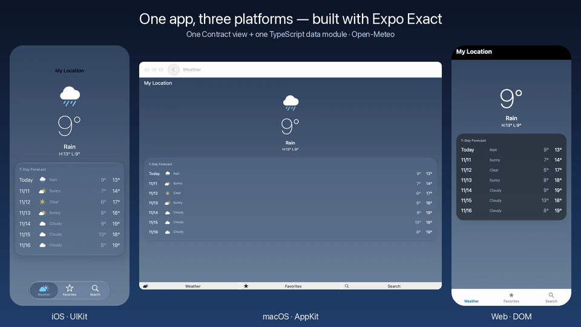
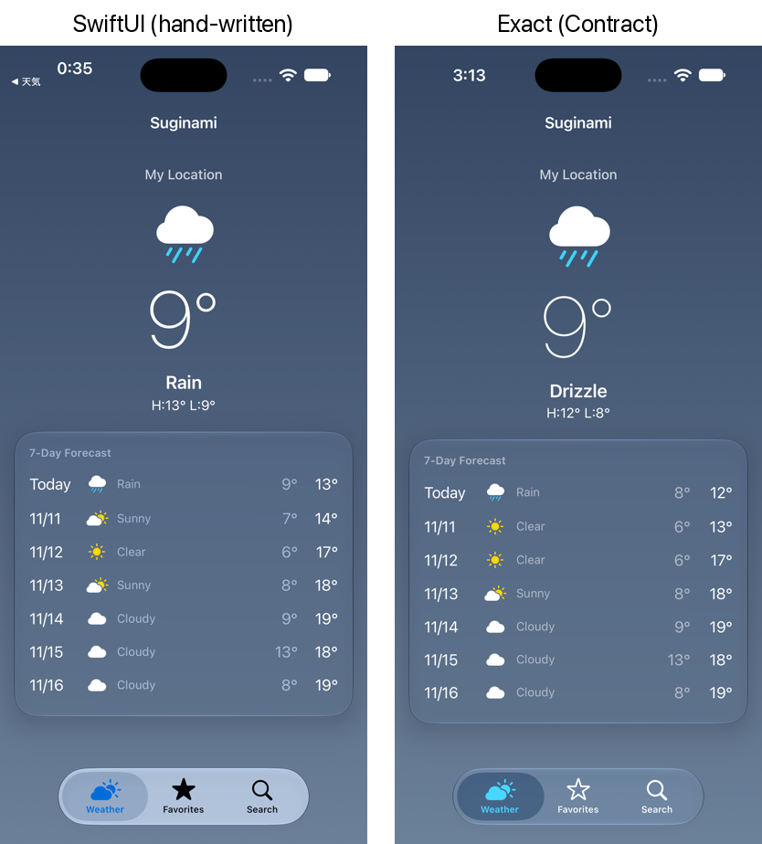

# exact-weather-demo

[English](README.md) | 日本語

[reflex-expo-app](https://github.com/kazutoyo/reflex-expo-app)（React Native / Expo）と[reflex-native-app-demo](https://github.com/kazutoyo/reflex-native-app-demo)（SwiftUI / Jetpack Compose）と同じ天気アプリを、Expoの新しいクロスプラットフォームランタイム[Exact](https://github.com/expo/exact)で作ったものです。ContractのView 1つとTypeScriptのデータモジュール1つが、iOS（UIKit）、macOS（AppKit）、Web（DOM）でネイティブに動きます。



- 3つのタブ：現在地の天気、お気に入り、都市の検索。API：[Open-Meteo](https://open-meteo.com/)（APIキー不要）
- 位置情報と逆ジオコーディングは`@exact/geolocation`と`@exact/geocoding`、お気に入りはJSONファイルに保存
- 見た目はSwiftUI版に合わせている



> [!NOTE]
> Exactは1.0前で、毎日のように変わっています。このアプリはexact2の`94b8671`（2026年11月）で作りました。

## アプリサイズと起動時間

同じアプリのSwiftUI版（[reflex-native-app-demo](https://github.com/kazutoyo/reflex-native-app-demo)）、React Native版（[reflex-expo-app](https://github.com/kazutoyo/reflex-expo-app)）と比べました。どれもReleaseビルドです。

| | IPA（iOS実機向け・署名なし） | 展開後 | UIが出るまで | 天気が出るまで |
|---|---|---|---|---|
| SwiftUI | 0.24MB | 1.0MB | 333ms | 917ms |
| Expo（SDK 58 / RN 0.88） | 18.1MB | 54.0MB | 333ms | 1,017ms |
| Exact | 11.1MB | 23.4MB | 350ms | 1,000ms |

起動時間は、iPhone 14（iOS 26.6.1）の実機でのコールド起動7回の中央値です。`tools/device-launch-time.py`（と`tools/rec.swift`）が、MacからiPhoneの画面を60fpsで録画し、起動のアニメーションの開始から測ります。どれも300ms前後はiOSの起動のアニメーションです。「天気が出るまで」には位置情報と通信の待ち時間が含まれます。`tools/launch-time.py`は同じことをSimulatorで行いますが、どのアプリにも約2秒が上乗せされます。

## ファイル

| ファイル | 内容 |
|---|---|
| `app.contract` | View。ルート（タブ3つと、それぞれのスタック）、状態、アクション、すべての画面 |
| `app.ts` | データモジュール。Open-Meteo、`app:/data/favorites.json`へのお気に入りの保存、使ってよい`grants` |
| `app.test.contract` | 振る舞いのテスト。同じファイルがWebでもiOSシミュレータでも通る |
| `strings/en.json` | 位置情報の許可ダイアログの説明文 |
| `tools/film.py`、`tools/compose.py` | Exactのエージェントで同じ操作をWeb・iOS・macOSで撮り、3つを並べた動画にする |
| `tools/record-web.mjs` | Webビルドを Chrome DevTools Protocol で3倍の解像度で録画する |
| `tools/device-launch-time.py`、`tools/rec.swift` | USBでつないだiPhoneでのコールド起動の時間を、画面の録画から測る |
| `tools/launch-time.py` | 同じことをiOS Simulatorで測る |

## 動かし方

このアプリは`../exact`にあるExactのチェックアウトをパスで参照します。

```sh
git clone https://github.com/expo/exact ../exact
bun ../exact/scripts/exact.mjs setup   # 最初に1回
bun install

bun exact.mjs web          # 開発用サーバー（http://127.0.0.1:8765/）
bun exact.mjs ios --run    # iOSシミュレータ
bun exact.mjs mac --run    # このMac
bun exact.mjs test web     # または test ios
bun exact.mjs verify       # テスト、ライト/ダーク、2つの画面幅、最大の文字サイズ
```

都市の検索は、Open-Meteoに英語の地名（`Osaka`、`Tokyo`）で問い合わせます。
