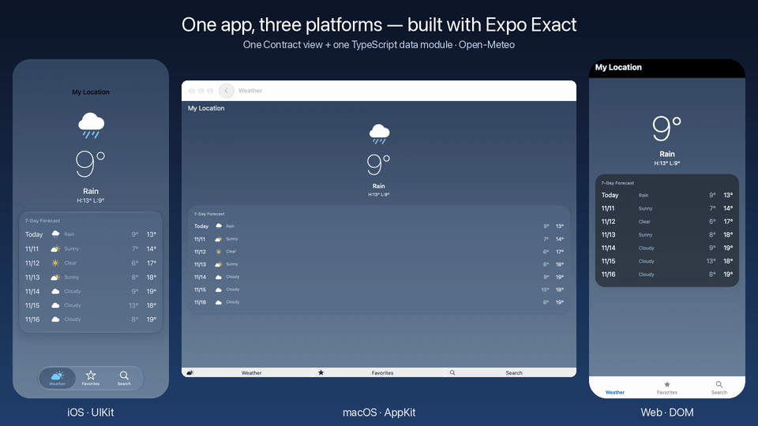
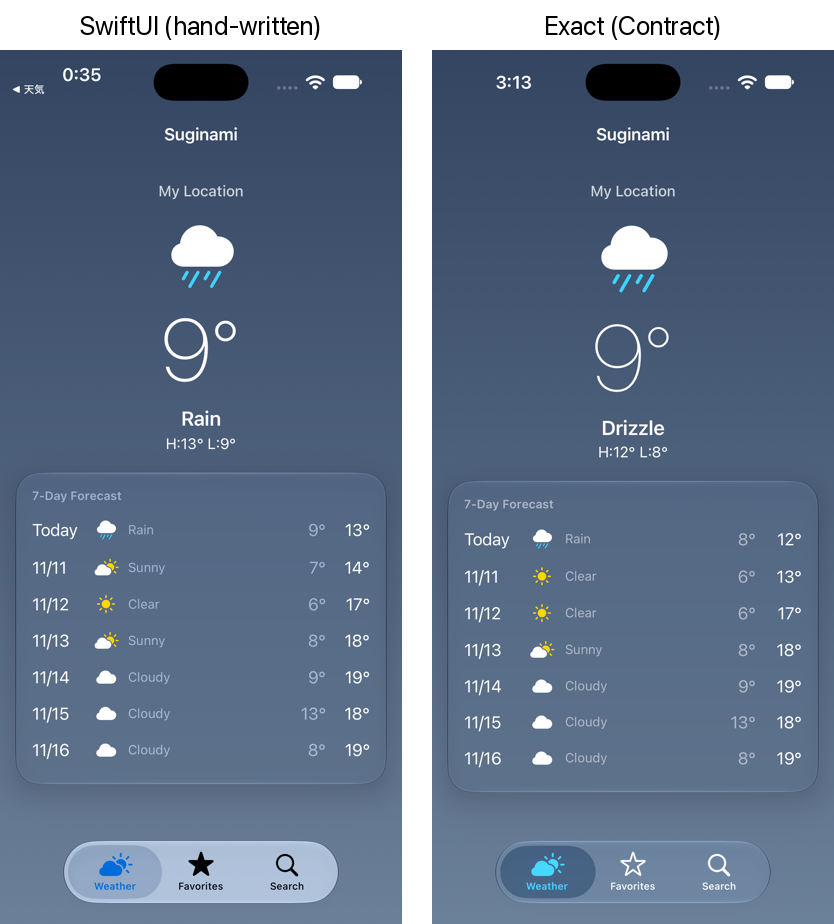

# exact-weather-demo

English | [日本語](README.ja.md)

The same weather app as [reflex-expo-app](https://github.com/kazutoyo/reflex-expo-app) (React Native / Expo) and [reflex-native-app-demo](https://github.com/kazutoyo/reflex-native-app-demo) (SwiftUI / Jetpack Compose), built with [Exact](https://github.com/expo/exact), Expo's new cross-platform runtime. One Contract view and one TypeScript data module run natively on iOS (UIKit), macOS (AppKit) and the web (DOM).



- Three tabs: weather at the current location, favorites, and city search. API: [Open-Meteo](https://open-meteo.com/) (no API key)
- Location and reverse geocoding through `@exact/geolocation` and `@exact/geocoding`; favorites in a JSON file
- The look follows the SwiftUI version of the app



> [!NOTE]
> Exact is pre-1.0 and changes daily. This app was built against exact2 `94b8671` (November 2026).

## Size and launch time

Compared with the same app in SwiftUI ([reflex-native-app-demo](https://github.com/kazutoyo/reflex-native-app-demo)) and React Native ([reflex-expo-app](https://github.com/kazutoyo/reflex-expo-app)), all Release builds:

| | IPA (iOS device, unsigned) | Unzipped | Cold launch to UI | To weather shown |
|---|---|---|---|---|
| SwiftUI | 0.24 MB | 1.0 MB | 333 ms | 917 ms |
| Expo (SDK 58 / RN 0.88) | 18.1 MB | 54.0 MB | 333 ms | 1,017 ms |
| Exact | 11.1 MB | 23.4 MB | 350 ms | 1,000 ms |

Launch times are medians of 7 cold launches on an iPhone 14 (iOS 26.6.1), timed from the start of the launch animation in a 60 fps recording of the phone's screen taken from the Mac by `tools/device-launch-time.py` (with `tools/rec.swift`). About 300 ms of each is iOS's launch animation. "To weather shown" includes the location fix and the network. `tools/launch-time.py` does the same on a Simulator, which adds about 2 s to every app.

## Files

| File | What it is |
|---|---|
| `app.contract` | The view: routes (three tabs, each with its own stack), state, actions and every screen |
| `app.ts` | The data module: Open-Meteo, favorites in `app:/data/favorites.json`, and the `grants` it may use |
| `app.test.contract` | Behavior tests; the same file passes on the web and in the iOS Simulator |
| `strings/en.json` | The location permission's purpose string |
| `tools/film.py`, `tools/compose.py` | Film the same flow on web, iOS and macOS with Exact's agent, then lay the three side by side |
| `tools/record-web.mjs` | Record the web build at 3x through Chrome DevTools Protocol |
| `tools/device-launch-time.py`, `tools/rec.swift` | Cold-launch timing on a USB-connected iPhone from a recording of its screen |
| `tools/launch-time.py` | The same on an iOS Simulator |

## Run it

The app uses an Exact checkout at `../exact` by path.

```sh
git clone https://github.com/expo/exact ../exact
bun ../exact/scripts/exact.mjs setup   # once
bun install

bun exact.mjs web          # the dev loop at http://127.0.0.1:8765/
bun exact.mjs ios --run    # an iOS Simulator
bun exact.mjs mac --run    # this Mac
bun exact.mjs test web     # or: test ios
bun exact.mjs verify       # tests, light/dark, two widths, the largest text size
```

City search queries Open-Meteo by name in English (`Osaka`, `Tokyo`).
